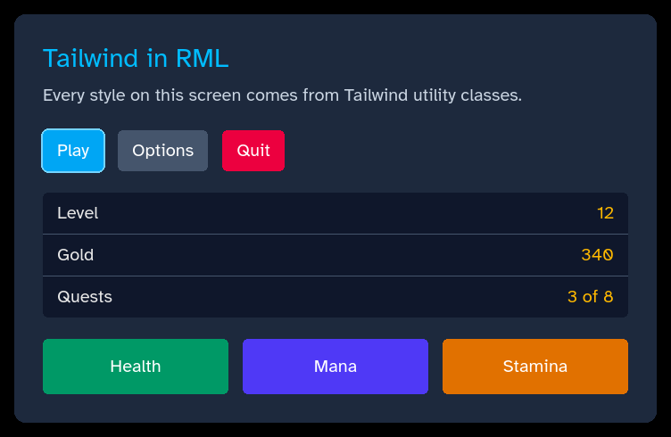
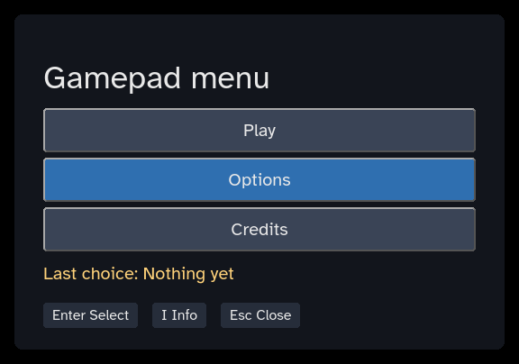
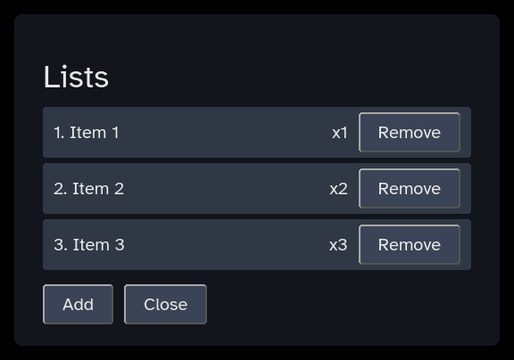
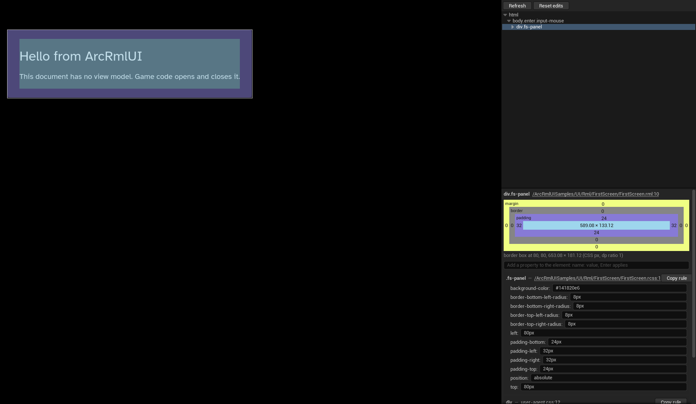
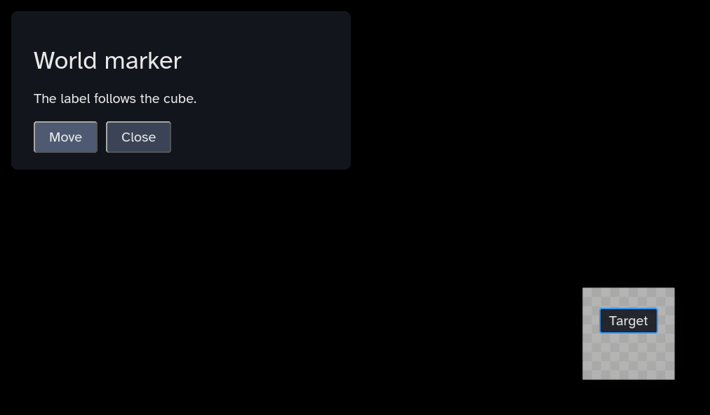

# Arc Lunzo Samples

Sample project and companion plugins for [Arc Lunzo (ArcRmlUI)](https://arcx.dev/), the plugin that builds game UI from
HTML and CSS documents. Run the demo, read the samples, copy what you need.

- Engine: Unreal Engine 5.8
- Platform: Win64
- Project: C++ (`ArcRmlUIHost.uproject`)

## Requirements

- The ArcRmlUI plugin from Fab, installed into the engine. It is not part of this repository. Product page:
  <https://arcx.dev/>. Documentation: <https://arcx.dev/docs/arcrmlui/>.
- Unreal Engine 5.8.
- A C++ toolchain for Unreal Engine 5.8 on Windows. The project and its plugins have C++ modules, so the editor builds
  them on first open.

## Open and run

1. Install ArcRmlUI from Fab into Unreal Engine 5.8.
2. Open `ArcRmlUIHost.uproject`. The project and its plugins have C++ modules, so they are built on first open.
3. Open the demo map `/ArcRmlUIDemo/Demo/Maps/L_ArcRmlDemo` and press Play. It is also the map a standalone game starts in.

The samples map is `/ArcRmlUISamples/Maps/L_ArcRmlSamples`; open it and press Play to pick a sample from the list.

## Plugins

All plugins are in `Plugins/` and depend on ArcRmlUI.

| Plugin | What it is |
| --- | --- |
| `ArcRmlUISamples` | Small samples, one feature per folder: document, style sheet, `README.md` and C++. Play the samples map and pick one from the list. Samples are opened with console commands such as `ArcRmlSamples.Open FirstScreen`. |
| `ArcRmlUIDemo` | A complete example game UI built from RML and RCSS with view models: splash, main menu, settings, save and load, lobby, HUD, pause menu, vendor, crafting and a game menu hub. All data is mock data. See [its README](Plugins/ArcRmlUIDemo/README.md). |
| `ArcRmlUIGameFeatures` | Game Feature actions for ArcRmlUI: preload documents and package documents per Game Feature plugin. You can copy it into your own project. See [its README](Plugins/ArcRmlUIGameFeatures/README.md). |
| `ArcRmlUITest` | Automated tests for ArcRmlUI (CQTest) and the fixtures they use. |
| `ArcRmlUIPackagingTest` | Content-only plugin that checks what the ArcRmlUI cook ships when Package Everything is off. See [its README](Plugins/ArcRmlUIPackagingTest/README.md). |
| `GameFeatures/ArcRmlUIGameFeatureTest` | Game Feature plugin that checks the ArcRmlUIGameFeatures packaging action in a packaged build. See [its README](Plugins/GameFeatures/ArcRmlUIGameFeatureTest/README.md). |

The last three exist to test ArcRmlUI; you can ignore them when you only want examples.

## Screenshots

| | |
| --- | --- |
|  |  |
|  |  |

## Licence

- This repository: MIT, see [`LICENSE`](LICENSE).
- ArcRmlUI is a separate product with its own licence on Fab and is not included here.
- Third-party fonts and icons keep their licence files beside them in the plugins' `Content` folders (`OFL-*.txt`,
  `LICENSE-*.txt`).

## Support

<https://arcx.dev/#support>
